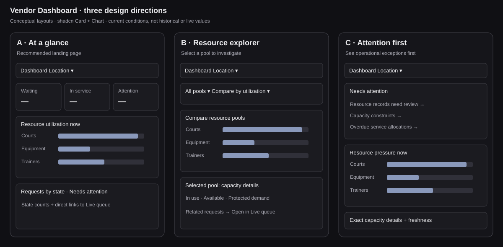

# Vendor Dashboard — three interface designs

Status: **Option A selected by the user**, with pool drilldown from B and a conditional attention card from C. Independent source review and bounded runtime QA are accepted with explicit limits recorded below; v3 display handoff and original-preview refresh remain separate.

## Scope and reference

A new **Dashboard** navigation item above Live queue will summarize the selected business/location. Staff need current conditions; admins may later need historical analysis. Keep all Call, Start, Complete, Interrupt, Recall and Restore commands in Live queue.

Reference: [Dashboard Shell 10](https://shadcnstudio.com/blocks/dashboard-and-application/dashboard-shell#dashboard-shell-10). Its sidebar, compact header, headline metrics and unequal-width chart panels inform the layout. Reuse GetPrio's existing workspace shell, semantic colors and Tabler icons rather than replacing navigation with the reference's CRM menus.

Charts will use the [shadcn Chart component](https://ui.shadcn.com/docs/components/base/chart), with its Recharts composition, ChartContainer, ChartTooltip and accessible labels. The existing Chart/Recharts scaffold is reused; `/dashboard/overview` is the Operations landing with Dashboard above Live queue.



## A. At a glance — recommended landing page

```text
Dashboard                           Location · Live / last updated
[Waiting now] [Requests using resources] [Pools needing attention]
[Resource utilization by pool — horizontal bars                 ]
[Requests by state — bars             ] [Needs attention         ]
```

A fixed, compact overview answers how busy the location is and where capacity is constrained. Each pool has its own exact in-use / capacity label. The primary chart compares utilization percentages across pools without summing unlike court, equipment and trainer units. Request-state bars use complete scoped counts, or explicitly say “loaded requests” if only the loaded list is available.

A conditional attention card shows reconciliation issues and overdue resource units. Clicking a pool opens capacity details; clicking a request-related issue navigates to Live queue. No new dispatch workflow is exposed.

Proposed interface and usage:

```tsx
type DashboardScope = { tenantSlug: string; locationSlug: string };
type ResourceDashboardProps = {
  scope: DashboardScope;
  onOpenQueue(): void;
};

<ResourceDashboard scope={scope} onOpenQueue={openLiveQueue} />
```

The module hides scoped reads, SSE invalidation/reconnect handling, chart configuration, freshness and loading/error states. The small interface prevents callers from reconstructing availability. This is the simplest everyday view, but it provides fewer analytical controls than B.

## B. Resource explorer — investigate one pool

```text
Dashboard                            Location · Updated timestamp
[Pool filter] [Compare by utilization / available / overdue]
[Pool comparison — ranked horizontal bars                       ]
[Selected pool details                  ] [Related requests      ]
```

The primary interaction is choosing a pool. A shadcn BarChart compares pools, and selecting a pool reveals its exact allocation, available capacity, protected demand and overdue units. Related requests link into Live queue only when the backend supplies the pool-to-request relationship.

Proposed interface and usage:

```tsx
type ResourceDashboardQuery = {
  poolIds?: string[];
  compareBy: "utilization" | "availableUnits" | "overdueUnits";
};
type ResourceExplorerProps = {
  scope: DashboardScope;
  query: ResourceDashboardQuery;
  selectedPoolId?: string;
  onQueryChange(query: ResourceDashboardQuery): void;
  onSelectPool(poolId: string): void;
  onOpenRequest(planId: string): void;
};

<ResourceExplorer scope={scope} query={query}
  selectedPoolId={selectedPool} onQueryChange={setQuery}
  onSelectPool={setSelectedPool} onOpenRequest={openInLiveQueue} />
```

The module hides transport, freshness, pool accounting and chart formatting while exposing shareable exploration state. This is the most general interface and scales to many pools, but it requires more user choices and caller coordination. Pool IDs must remain scoped and labels must remain human-readable. Its flexibility makes it easier to build confusing combinations unless supported comparisons are constrained.

## C. Attention first — act on exceptions

```text
Dashboard                            Location · Updated timestamp
[Needs attention — ranked issues with links                     ]
[Resource pressure — horizontal bars    ] [Queue demand — bars   ]
[Exact capacity details by pool                                 ]
```

A ranked issue list leads the page: reconciliation required, no available pool capacity, then server-reported overdue units. Healthy conditions show an all-clear state only when the server confirms it. Current capacity and request-state charts support the issue list rather than dominating it.

Proposed interface and usage:

```tsx
type DashboardTarget =
  | { kind: "resource"; poolId: string }
  | { kind: "requests"; filter: "waiting" | "overdue" }
  | { kind: "reconciliation" };
type DashboardAttentionProps = {
  scope: DashboardScope;
  onInspect(target: DashboardTarget): void;
};

<DashboardAttention scope={scope} onInspect={openOperationalContext} />
```

The module hides snapshot freshness, issue ordering and accessible chart presentation. The caller handles navigation through one typed callback. This makes correct operational use easy and avoids duplicate service commands, but makes healthy pools less prominent and does not provide B's exploration flexibility. Backend-defined issue semantics are required; a full pool alone is a capacity condition, not proof that every waiting request is blocked.

## Comparison and synthesis

A has the smallest interface and clearest everyday reading order. B is the most flexible and exposes more state, at the cost of more ways to combine filters incorrectly. C concentrates on correct operational follow-through and hides issue classification behind a small navigation interface. All three can use one coherent server snapshot and one scoped SSE subscription, rather than independently fetching every widget and producing inconsistent timestamps.

Recommend **A as the Dashboard landing page**, with **B's pool detail drilldown** and **C's conditional attention card**. Keep the default view fixed; do not add a widget builder initially. The module should own a coherent read model and expose scope plus navigation, not expose raw ledgers or lifecycle commands to each widget.

## Data and accounting boundaries

The current resource snapshot supplies `capacity`, `allocatedUnits`, `availableUnits`, `protectedUnitsNow`, `overdueUnits`, `reconciliation.required` and `asOf`.

- Label the combined `protectedUnitsNow` as **Protected demand** until the backend provides separate queue-hold and booking-reservation counts.
- Start with allocated / configured-capacity bars and exact availability text. Do not stack protected demand and allocations until the backend guarantees they are disjoint. Overdue units are a subset of allocated units, not another capacity segment.
- Full request counts need a complete scoped projection; a paginated frontend list is not a business-wide total.
- Historical utilization, throughput, wait-time trends and previous-period comparisons need recorded history endpoints. The current snapshot cannot support honest time-series charts.
- Planned end times never release capacity. Only explicit backend lifecycle outcomes change allocation state.
- Unknown data displays “Unavailable” or “—”. Keep the last good snapshot's timestamp and clearly mark stale/disconnected data.
- Do not add revenue, forecasts or unrelated CRM metrics just because they appear in the reference.

## Responsive and accessible behavior

Design from narrow mobile upwards: one column, readable labels, approximately 44px interactive targets, charts sized to their containers and exact values readable without hover. Tablet uses two columns where useful; desktop uses a wide primary chart and a smaller attention card. Pool detail becomes a Sheet on mobile. All charts include text equivalents, semantic legends and keyboard-accessible drilldowns. Preserve staff/admin permissions and clear scope changes before showing fresh data.

## Live queue cleanup and recovery placement

Remove the “Other in service / Other called / Other waiting” panels, the current-flow duplicate Current queue list, and the Resource pool operations cards from Live queue. Retain resource-reconciliation warnings when present.

Place **Request recovery directly below Service requests**, collapsed by default:

- **Skipped requests:** show only when nonempty; Recall preserves the same request's original priority and queue age.
- **Carried over:** read-only carry-over view, retaining existing activation/status information.
- **Missed recovery:** retain the existing Restore command and its queue-open, intake, threshold, credential and deadline checks. Recall and legacy Restore are not interchangeable.

Public links, Join QR and display approval live together in a second collapsed **Public access and displays** disclosure. Keep unfinished-service recovery visible only when records need attention. Consolidate intake to one **New service request** action.

## Implemented read semantics and remaining acceptance

The selected layout uses precise supported headline values: Waiting now is `readyWaitingCount`, while Requests using resources is distinct active-allocation ticket IDs. Waiting now counts all waiting requests for the current queue date, excluding bookings scheduled for later; it does not establish resource availability, plan validity, READY stages/counters or next eligibility. Requests using resources is not a complete in-service total. Waiting/called charts say loaded requests. The authorized local `resource-operations` DTO is scope-validated; missing/unknown availability quality is unknown, and only observed quality supports point-in-time available units. No production/internal not-ready producer fallback, historical series, totals expansion or runtime activation is introduced.

Source implements scope/session disposal, authorization-loss suppression, stale last-good timestamp, retry, scoped authenticated ready/hint/heartbeat stream recovery and foreground poll/focus fallback. Exact additive pool-quality contract is coordinated with the API owner. Independent source review and bounded mobile/light/dark/keyboard/focus and authenticated API/SSE acceptance are recorded below with explicit coverage limits. Technical limits stay in documentation; product copy uses concise, familiar terms.

## Dashboard bounded runtime acceptance and display handoff — 21 October 2026

Head accepted the bounded Dashboard evidence with no behavioral FAIL. The verified report is `/Users/carloabella/.codex/local-test-harnesses/vendor-dashboard-review-20261020T231536/causality-harness-v2/output/playwright/QA-EXECUTION-REPORT.json`, SHA-256 `d76d5b7031b3e7353113511ab4e9e1793d947efaeee375a4137448c56888a225`. Twelve numeric script cases and ten actual Dashboard SSE → own GET → visible-value cases passed (58–137 ms), covering publication, Call, Start, Complete, Interrupt and hold release. Assigned staff GET/SSE passed; unassigned/revoked access returned 403 and old streams closed. Head reviewed the images. All QA-owned browser sessions, test API/frontend and disposable DB services stopped; original/preserved services were untouched.

Coverage is bounded: first-publication UI causality remains untested (two other publication cases passed); configuration event/own-GET revision/capacity and visible UI change passed, but strict DOM latency was not captured. A pure queue.read-without-operate role cannot be represented by current product roles; normal assigned staff performed only GET/SSE, without permission overrides. The tested visual matrix was 1440 light/dark, 390 light, plus 768 light and 390 dark lower-page/Sheet checks; no horizontal overflow and Sheet focus/return passed in those checks. Long overflowing Sheet scroll stress and the full all-theme/all-breakpoint matrix remain untested. This is not unrestricted/full-matrix acceptance.

Final API/Head semantic correction: headline **Waiting now**, caption **Excludes bookings scheduled for later.** The legacy `readyWaitingCount`/frontend `readyToCall` names remain for compatibility. Their value is all waiting requests for the current queue date excluding future bookings, not resource availability, valid plans, READY stages/counters, or next eligibility. Eligibility stays in Live queue. Earlier call-ready interpretation was incorrect; previously measured numeric deltas remain valid. The v3 display-only correction also formats singular/plural units in pool values and Sheet details. No runtime logic or API expansion is introduced.

Source provenance: independent source review passed frozen v2 (22 verified files); v1 functional suite 395/395 and typecheck passed, and v2's sole CSS full-span correction built successfully. The versioned v3 packet records focused existing Dashboard/presentation tests, typecheck/build and exact changed-file hashes/delta; no full functional or command-runtime rerun is claimed for this display/comment/documentation-only follow-up. Hook, backend, accounting logic and frozen functional behavior remain unchanged. Existing focused Dashboard/presentation tests passed 13/13; frontend typecheck passed; v3 production build passed in 19.62 seconds with the existing Chart/Tailwind selector and chunk-size advisories.

Separate blocker: the normal migration runner's lexical dependency ordering bug remains unresolved. The test-only dependency-ordered bootstrap succeeded; that does not establish production migration readiness. Original main preview was subsequently refreshed by primary after independent v3 review: reviewed API source verified, API5007 restarted as PID46339 with the same private fixture and guarded launcher; frontend5187 remained PID70155 and returned HTTP200. Authenticated assigned-staff VD Sports Club / Demo Courts Dashboard showed Waiting now 0, requests using resources 3, pool usage Courts4/4, Basic Equipments14/20, Trainers3/4, and Trainers detail '1 unit' available. All15 business-table counts and complete row digests matched before/after, including the tickets present at that earlier Dashboard-only checkpoint; this is not the duration-delivery baseline. Read-only preview checks performed no lifecycle/configuration commands, migrations or reseed. Evidence: original-preview-before.json, original-preview-after.json, original-preview-verification.json and original-preview-v3-dashboard.png in the durable review packet. No commit, push, merge, deployment or production activation occurred.

## Store-hours-aware request duration — source handoff, 21 October 2026

The new V4 service-request duration control shows the server-selected closing time and a provisional maximum fitting duration. It uses the approved `serviceHoursWindow` on selection-options (`status`, DB-clock `observedAt`, timezone, open/close instants, remaining whole minutes, provisional marker). Dynamic hours metadata does not change `catalogRevision`. A client-only monotonic timestamp captured at request start conservatively includes network latency; the countdown uses server instants plus elapsed time, never browser weekdays, local wall-clock scheduling, adjacent-window merging or queue extensions.

This is an **earliest-start-now limit**, not promised queue start, admission or resource availability. Exact finish at closing fits; elapsed time can make the same count too long. Linear resources run in parallel (maximum duration); ordered stages use the sum of each selected stage's maximum root-resource duration. Quantities do not multiply time; contained extras add no time. Top-level transported direct-resource rows are canonical roots mapped by their own service ID; nested extras inherit their root stage. Missing/duplicate stage mappings are unavailable, not guessed.

All affected selected duration policies are intersected, including min-based steps and fixed defaults. The shared numeric field and buttons preserve invalid typed strings and child selection identities; no silent truncation, extra deletion or first-resource policy clamp. Closed, unknown, policy-incompatible or minimum-no-fit states explain the publication block while draft Save remains available. Focus/visibility/online/scoped queue hints and the existing foreground refresh update open forms without resetting drafts. The amend form shares count-control consistency without client-side new-intake hours gating; server-side amendments of newly tagged requests still revalidate current hours, while historical untagged amendments retain existing behavior. Legacy V3 publication and active/history records are unchanged.

Full source and the latest six documents were snapshotted before edits at `/Users/carloabella/Backups/GetPrio/vendor-duration-hours/2026-10-21T00-49-18+0800` (1601 source entries; source manifest `c3c8e78f0ba98a460aa28b876a5f2f855d667bad97e6fa3badca9d321c7abd12`). Focused duration/preservation/refresh tests passed 34/34; final frontend typecheck/build logs and exact source hashes accompany the versioned packet. Dashboard v3 implementation is preserved. At this source-handoff checkpoint, independent focused source review and a bounded isolated runtime pass were pending; the final bounded QA and local-delivery evidence below now supersedes that pending status. No runtime acceptance was claimed by the source checkpoint. Server publication remains authoritative, and the backend companion is reviewed separately; this is not production enforcement, migration readiness, deployment or activation evidence.

## Store-hours duration — final bounded QA and local delivery, 21 October 2026

**Status: bounded runtime PASS after frontend v2 layout correction; local preview delivery verified.** This supersedes the duration source-handoff's pending runtime status, while retaining that checkpoint and its pre-edit snapshot/test provenance. Backend v2 and frontend v2 source/runtime packets remain immutable. Source review passed; frontend focused tests were 34/34, typecheck passed, and the v2 build passed in 24.93 seconds. This final update changes documentation only.

Authoritative final QA: `/Users/carloabella/.codex/local-test-harnesses/duration-store-hours-qa-20261021-readonly/runtime/QA-FINAL-REPORT.json`, SHA-256 `24190156f26e9e3ba9d6bfdce9a0cc0dc4a65d93fccfa9e44993e3927f80fecd`. A single fresh isolated fixture used normal owner authentication. A 45-minute count 3 draft was preserved against a roughly 34-minute window; direct Publish rejected with `409 SERVICE_DURATION_EXCEEDS_STORE_HOURS` and fresh window metadata, leaving no published version, hold or allocation. Reopening retained 3; entering 2 showed the correct maximum 2, disabled + and 30-minute total. Natural aging over 35 samples / 34.746 seconds reduced maximum 2→1 while retaining entered 2 and showing the warning, without clock changes, hour writes or manual refresh. A valid 15-minute publication passed; all three duration-bearing marker locations were tagged, while the separate organizational service root was correctly untagged. After shortening only synthetic hours to about 9 minutes remaining, tagged Call rejected with the same 409 and fresh metadata; the ticket stayed waiting with no holds/allocations and one published version.

Frontend v1's 16-pixel input/suffix overlap was resolved by the independently reviewed v2 layout-only change. Actual 1280 desktop and 390 mobile checks showed readable count 2, suffix below, 44-pixel buttons, input widths approximately 224.7 / 202 pixels, focus inside and no horizontal overflow. An open form's explicit Refresh hours changed the helper maximum 30→15 minutes and input maximum 2→1, preserving chosen 2 with warning and disabled +. Final frozen backend 642-file and frontend 457-file fingerprints were unchanged. Only QA-owned API5009, UI5189, DB56790 and browser processes were stopped; fixture files/private evidence were retained and original/preserved services were untouched by QA.

**Coverage limits:** exact closing/1-ms overshoot; split/overnight/24-hour/timezone/DST windows; stage maxima/sums and quantity/extra arithmetic are source/deterministic evidence here, not additional live cases. Tagged Start, Retry, amendment, receipt replay-first behavior, malformed/mixed/unsupported provenance and historical V4 compatibility are reviewed source/focused-test coverage only. The runtime fixture had no selected extras, so extra-identity preservation has source/test coverage, not actual extra-UI runtime proof. Full theme/breakpoint matrix, physical mobile keyboard/device acceptance and old/history/active production commands remain untested. No full-rework completion or production readiness is implied.

Primary's delivery evidence: `/Users/carloabella/.codex/local-test-harnesses/duration-store-hours-review-20261021/LOCAL-DELIVERY-VERIFICATION.json`, SHA-256 `8359f6dea25d72699f9f9b12d5dce66e7d1452f276d46af44ea7683dc35cec44`. Reviewed source union was verified; API5007 ran as PID56057 and UI5187 remained PID70155. Authenticated assigned staff in VD Sports Club / Demo Courts saw closing 3:00 AM, maximum 1 hour, chosen count 1 and disabled +. The unsaved local inspection selection was discarded; no original preview Save, Publish or lifecycle command ran. All **19 business-table complete row digests/counts matched before and after, with 13 tickets before and after**. The earlier Dashboard-only ticket baseline changed before duration source edits and is not the duration-delivery baseline.

The normal migration runner's lexical dependency ordering bug remains unresolved. Successful test-only ordered bootstrap (158 migrations, zero pending in this isolated fixture) does not establish production migration readiness. The current preview delivery is local only; no commit, push, PR publication, merge, deployment or production activation is claimed. No additional product/test edits, process changes or database actions were performed for this final documentation update.

## Waiting-request hours eligibility — final bounded local acceptance (2026-10-21)

This followup is implemented, independently source-reviewed and locally delivered with bounded runtime acceptance. It preserves Dashboard v3, duration v2, existing historical requests and all broader rework acceptance gaps. It supersedes this followup's source-only/runtime-pending handoff; earlier checkpoints and immutable backend v2/frontend v1/v2 packets remain evidence of their respective revisions.

The server supplies `serviceHoursEligibility` on published plans, waiting rows and counter targets: `status` is `fits | does_not_fit | unavailable | not_enforced`, with `reason: {code,message} | null`, `requiredDurationMinutes: number | null`, approved `serviceHoursWindow | null` and `nextChangeAt: string | null`. Newly server-tagged requests are checked against the current earliest-start store window; this is no promise of resource availability or queue-start time. Historical untagged requests remain `not_enforced` with neutral “Earlier request · hours limit not applied” when shown; there is no inferred fit, new hours conflict, rewrite or retag. Unknown/malformed tagged requests are unavailable. A blocked/unknown request is excluded from the backend's Next eligible result. The frontend uses that exact server candidate, including an empty result, without a resource-only loaded-list fallback. FIFO stays separate. A manually selected blocked request remains inspectable as **Selected request**, with a distinct store-hours row/card reason and disabled Call, independent of resource-conflict status.

The server emits a scoped invalidation at the exact fit boundary (`close − required duration + 1 ms`); its 25-second heartbeat also checks opening/recovery changes. Stream comparison scans the complete authorized scope in 1,000-row batches under one database clock. An incomplete scan or the 2-second/10,000-row budget closes the stream rather than presenting a partial healthy result. The frontend trusts matching authorized `ready`/heartbeat health, not `open` alone. Boundary hints and authorized heartbeats invoke actual scoped GETs; heartbeats do not manufacture `observedAt` or receipt freshness. A coalesced trailing read preserves an invalidation arriving during an in-flight read. Browser 15-second polling is disconnected/unhealthy recovery only; error/gap handling and token/location cleanup are preserved. A failed GET keeps the actual last successful snapshot/receipt and the honest stale/update warning. No browser schedule calculates eligibility; elapsed timing never releases capacity or changes request outcomes.

Final independent QA report: `/Users/carloabella/.codex/local-test-harnesses/duration-store-hours-qa-20261021-readonly/eligibility-reuse-v1/QA-FINAL-REPORT.json`, SHA-256 `c9df7a9ca54f99ec74d4de524d22c937689a36fcb0de199bdf448b7d8fa1b759`, **BOUNDED_QA_PASS**. With frontend v1/backend v2, a time-only server event caused the browser's own counter GET after 7.506 ms and its response after 834.776 ms; card/row change rendered in about 1.3 seconds, without focus, navigation, manual refresh or a mutation at that boundary. FIFO VD009 became `does_not_fit`; backend Next eligible VD010 remained `fits`. Manual blocked selection retained its warning and disabled Call, with separate resource-conflict-free status. A synthetic hours reversal cleared the warning while retaining selection within 470 ms. Reviewed frontend v2 changed heartbeat freshness only: 83.640 seconds of healthy stream observation kept the stale banner absent through real GET snapshots; a **browser-only synthetic 503 interception** for 94.033 seconds preserved the last successful server timestamp/receipt and showed both stale/update warnings. Removing interception allowed normal heartbeat GET recovery and cleared those warnings without server writes. This is a browser transport-failure test, not a server-failure claim. The primary boundary setup was not repeated for v2.

Backend focused evidence is 62 passing tests. Frontend v1 has 25/25 focused tests, typecheck and a 59.82-second build; frontend v2 has the relevant 6/6 stream/readqueue tests plus typecheck, with no full build/full-suite repetition. Independent source review accepted both revisions. Final literal runtime fingerprints had no mismatches across 645 backend and 461 frontend files. Only QA-owned API5009/UI5189/DB56790/headless processes were stopped; retained fixture/private evidence files were preserved. Runtime disconnect/reconnect, unknown eligibility and amendment reversal remain source/test evidence only. Direct rejected-Call atomicity was not repeated in this feature run; prior duration runtime and current source evidence remain its provenance. Screenshots show the wide card/table; this adds no full responsive/theme matrix or physical-device acceptance claim.

Final original-preview delivery: `/Users/carloabella/.codex/local-test-harnesses/queue-hours-eligibility-review-20261021/LOCAL-DELIVERY-VERIFICATION.json`, SHA-256 `cc51fe13ddcfcf5174b714dbe4dd8b2d661ca7263ead0b3485d087996a2bc242`. The exact reviewed source union was verified; original API5007 was PID86316 and UI5187 stayed PID70155. Assigned-staff authentication in VD Sports Club / Demo Courts worked, but the current queue day was **not opened and had zero current rows**: no original-preview hours warning, historical-neutral row or candidate behavior is asserted from that screen. No business action, Open queue, lifecycle/configuration command, save, publish, retag, migration or reset occurred. All 19 business-table complete row digests/counts matched before/after, with 13 tickets unchanged. Historical requests were not rewritten or retagged.

The normal migration runner's lexical dependency-ordering defect and broader rework/acceptance gaps remain unresolved; the earlier test-only ordered bootstrap does not prove production migration readiness. This is a bounded local milestone, not full-rework completion, merge, deployment or production readiness. This final synchronization changes only the six existing documents; no additional product/test/runtime/database/Git-publication action is part of it.
